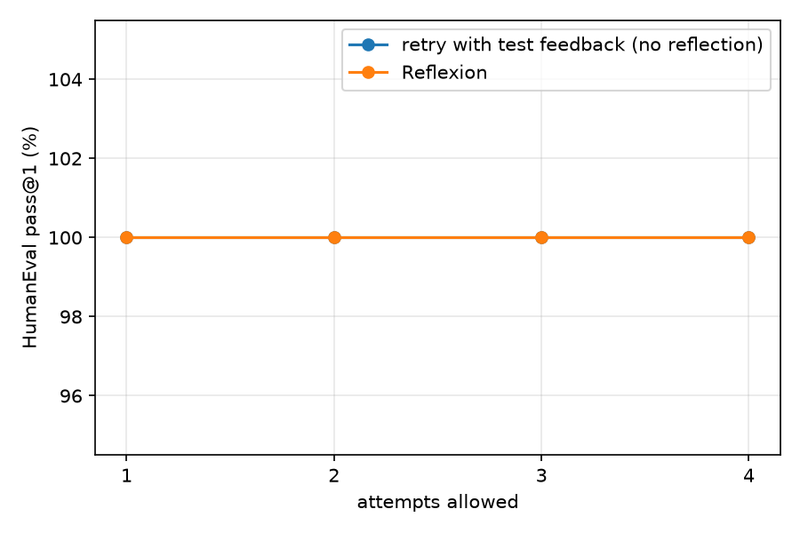

# Results: haiku-full

Model: **haiku (Claude Code CLI)** · problems: 164 · max attempts 4 · memory 3 reflections · 6 self-generated tests

| Strategy | first attempt (base) | final pass@1 | fixed | broke | mean attempts | LLM calls / problem |
|---|---|---|---|---|---|---|
| retry | 100.0% | **100.0%** | 0 | 0 | 1.02 | 2.02 |
| reflexion | 100.0% | **100.0%** | 0 | 0 | 1.02 | 2.04 |

Paper (GPT-4, HumanEval Python): base 80% → Reflexion 91%.

*fixed* = wrong at the first attempt, correct at the end; *broke* = the reverse (a correct first attempt abandoned because a self-generated test was wrong).

## Does self-reflection help? (paired comparison)

Solved only with Reflexion: **0** · only with plain retry: **0** · exact McNemar p = 1.000 (n = 164)

## Reliability of self-generated tests (reflexion run)

| verdict | correct | incorrect | n |
|---|---|---|---|
| internal tests pass | TP 100% (paper 99%) | FP 0% (paper 1%) | 163 |
| internal tests fail | FN 100% (paper 40%) | TN 0% (paper 60%) | 4 |

