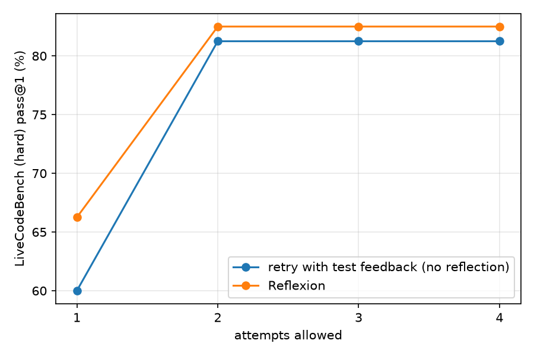

# Results: lcb-hard-haiku

Model: **haiku (Claude Code CLI)** · problems: 80 · max attempts 4 · memory 3 reflections · 6 self-generated tests

| Strategy | first attempt (base) | final pass@1 | fixed | broke | mean attempts | LLM calls / problem |
|---|---|---|---|---|---|---|
| retry | 60.0% | **81.2%** | 17 | 0 | 1.31 | 2.39 |
| reflexion | 66.2% | **82.5%** | 13 | 0 | 1.38 | 2.83 |

The paper did not use LiveCodeBench; its closest setting, LeetCode Hard (Python), reports GPT-4 7.5% → Reflexion 15.0%.

*fixed* = wrong at the first attempt, correct at the end; *broke* = the reverse (a correct first attempt abandoned because a self-generated test was wrong).

## Does self-reflection help? (paired comparison)

Solved only with Reflexion: **2** · only with plain retry: **1** · exact McNemar p = 1.000 (n = 80)

## By platform

| Strategy | platform | n | first attempt | final pass@1 |
|---|---|---|---|---|
| retry | atcoder | 60 | 53.3% | 78.3% |
| retry | leetcode | 20 | 80.0% | 90.0% |
| reflexion | atcoder | 60 | 58.3% | 78.3% |
| reflexion | leetcode | 20 | 90.0% | 95.0% |

## Reliability of self-generated tests (reflexion run)

| verdict | correct | incorrect | n |
|---|---|---|---|
| internal tests pass | TP 84% (paper 99%) | FP 16% (paper 1%) | 76 |
| internal tests fail | FN 29% (paper 40%) | TN 71% (paper 60%) | 34 |

